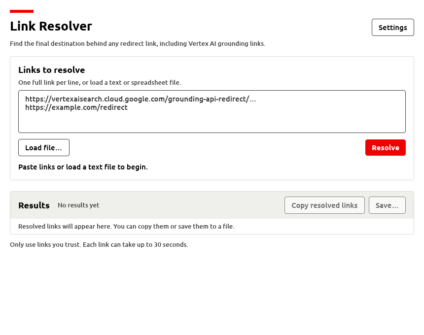

# Link Resolver

Find the final URL behind any HTTP redirect, including Vertex AI grounding links.
Includes a minimal Rust desktop application, an optional CLI, and the original
Bash/PowerShell scripts.



The window follows the system theme; the dark variant is shown in
[`docs/gui-dark.png`](docs/gui-dark.png).

## Application: no installation or administrator access

Ready-to-share x86-64 builds are in `dist/`:

- `dist/link-resolver-gui-windows-x64.zip`
- `dist/link-resolver-gui-linux-x64.tar.gz`

Each archive includes the desktop app, optional CLI, `QUICKSTART.txt`, and an
example `urls.txt`. Unpacked copies are in `dist/gui-windows-x64/` and
`dist/gui-linux-x64/`. Terminal-only editions (`link-resolver-windows-x64.zip`,
`link-resolver-linux-x64.tar.gz`, the Linux one fully static) are built alongside.
`dist/SHA256SUMS` contains checksums. These are local build artifacts (not tracked
as source files); `packaging/package-dist.sh` rebuilds all of them. Linux was
runtime-tested here; Windows was cross-compiled and its imported DLLs checked, but
was not runtime-tested on Windows.

The application opens a **desktop window**, without a console window on Windows.
End users need only the binary for their operating system, not Rust, curl, or
PowerShell.
An internet connection and permission to run downloaded applications are needed.
Company security policies can still block unsigned executables.

Published releases also include macOS archives for both processor architectures:
`link-resolver-gui-macos-arm64.zip` (desktop app + CLI) and
`link-resolver-macos-arm64.zip` (terminal only) for Apple Silicon;
`link-resolver-gui-macos-x64.zip` and `link-resolver-macos-x64.zip` for Intel.
All target macOS 13+ and are ad-hoc signed, **not Developer ID signed or notarized**.

- **Windows (64-bit):** open `link-resolver.exe` by double-clicking it.
- **Linux (x86-64):** launch `link-resolver` from your desktop's file manager,
  or run `./link-resolver`. If necessary, run `chmod +x link-resolver` first;
  this does not need administrator access. A normal desktop with X11/Wayland and
  OpenGL support is required. Linux file pickers use the desktop's XDG portal.
  If no portal is available, URLs can still be pasted into the text box and
   results copied to the clipboard.
- **macOS (Apple Silicon or Intel, macOS 13+):** choose the `arm64` ZIP for Apple
  Silicon or `x64` for Intel, extract it and double-click
  `Link Resolver.app`. It can run from Downloads; moving it to Applications is
  optional. Gatekeeper may block it. Only if you trust the download, attempt to
  open it and then use **System Settings > Privacy & Security > Open Anyway**.
  Organization policies may prohibit the override or require administrator
  approval; do not disable Gatekeeper globally.

The window offers:

1. A multiline **URL box** — paste one link per line. Links may be written as
   `https://example.com/page`, `www.example.com` or `example.com/page`.
2. **Load file…** — select a text file (one link per line) or a CSV/TSV
   spreadsheet file. The app tells them apart by extension. With a spreadsheet
   it finds the column that holds links: one such column is used straight away;
   if there are several, or none, a dialog previews the file as a grid with a
   radio button over each column, the selected column tinted, cells that would
   be skipped struck through, and a "First row is a header" switch for files
   without headers (see [`docs/gui-columns.png`](docs/gui-columns.png)). Rows in
   the chosen column that do not hold a link are skipped and listed by row number.
3. **Resolve** (or Ctrl+Enter) — start a batch with live progress and per-link results.
4. **Stop** — stop after the current URL finishes (up to thirty seconds).
5. **Results** — a table below the input with one row per link: number, status,
   the original link (shortened when long; the full text is in the text box and
   the CSV) and the destination, always shown in full. A failed row explains why
   in place of a destination. In a narrow window or at large text sizes each
   link is shown as a labelled block instead.
6. **Copy** / **Copy resolved links** — copy one destination, or every
   successful destination one per line, from the bar at the top of the results.
7. **Save…** — choose the whole table as a CSV spreadsheet (link, destination,
   status, error) or only the resolved links as a text file (one per line,
   ready to load back in), then pick a new file name in a writable folder.
8. **Settings** — theme (follow system, light, dark), text size, reduce motion
   (shown open in [`docs/gui-settings.png`](docs/gui-settings.png)).

Networking, file loading, dialogs and export run on background threads; the
window remains responsive. Input and file buttons are disabled while working.
Results from stopped batches can be copied or saved. Save before resolving a new
batch or closing the window; results are held in memory, not saved automatically.

The window follows the system light/dark setting unless Settings says otherwise,
exposes every control to screen readers through AccessKit, announces progress and
completion, is fully keyboard operable (Tab, Enter, Space, Ctrl+Enter) and zooms
with Ctrl and +/-/0. Settings and the window size persist in eframe's per-user
data folder (`~/.local/share/linkresolver/` on Linux, `%APPDATA%\linkresolver\`
on Windows) as a small `app.ron` file; no URLs or results are written there.
On macOS the same shortcuts use Cmd instead of Ctrl; native file dialogs,
clipboard, system theme and AccessKit's VoiceOver integration are used. CI tests
and packaging checks do not replace an interactive accessibility assessment.
Colours, type sizes and fonts come from `src/theme.rs`, which follows the brand
palette; see [`docs/accessibility-assessment.md`](docs/accessibility-assessment.md)
for the assessment and the agreed interpretation of the brand book. The bundled
Ubuntu Medium and Bold fonts are in `assets/fonts/` under the Ubuntu Font Licence.

Text input files must be UTF-8 with one link per line. Empty lines and
`#` comments are ignored; UTF-8 BOMs and Windows line endings are supported.
See [`examples/urls.txt`](examples/urls.txt). CSV files may use commas,
semicolons or tabs (sniffed from the first line; `.tsv` always means tabs). A
header row is assumed when the first row holds no links; the dialog's switch or
the CLI's `--header` / `--no-header` flags override that. See
[`examples/links.csv`](examples/links.csv). The latest batch stays in memory
until replaced or the app closes. Saving is optional; existing files are never
overwritten. CSV columns are `input_url`, `resolved_url`, `status`, and `error`.
CSV quoting handles commas/quotes; formula-like text is prefixed with an apostrophe
so spreadsheet applications treat it as text.

URLs are resolved one at a time, with a shared HTTP client, a thirty-second timeout
per URL and at most ten redirects. One failure does not stop the batch. The app
uses GET but does not read response bodies. A final HTTP 403/404 still counts as
a resolved destination, not proof that its content is accessible. HTML/JavaScript
redirects are not supported. TLS certificates are verified using the OS trust
store; TLS is not disabled. Normal proxy environment variables are supported.

Only use trusted links: the application contacts every redirected destination,
including destinations on your local network. Expired links may not resolve to
their original destination. No special Google credentials or API key are needed
for public redirect links; links requiring authentication can still fail.

### Optional command-line usage

```sh
./link-resolver-cli 'https://example.com/redirect'
./link-resolver-cli --file urls.txt --output results.csv
./link-resolver-cli --file links.csv --column Website --output results.csv
./link-resolver-cli --help
./link-resolver-cli --version
```

```powershell
.\link-resolver-cli.exe --file urls.txt --output results.csv
```

Multiple URL arguments and multiple `--file` arguments can be combined. For a
CSV/TSV file with exactly one link column no `--column` is needed; with several
or none, the CLI lists the columns and asks for `--column` (a header name or
1-based number). Skipped rows are reported on stderr as a warning.
Command-line mode prints progress/results; exit code is 1 if any URL fails or
input/export fails, and 0 on success. A partial-failure batch is still exported.
Opening the CLI without arguments retains the original terminal menu.

### Building from source (developers only)

Install Rust 1.95+ with Cargo and the platform's build tools, then:

```sh
cargo build --release --locked
```

The GUI binary is `target/release/link-resolver` on Linux or
`target/release/link-resolver.exe` on Windows; the optional CLI is named
`link-resolver-cli[.exe]`. Copy the binary to a writable
folder on the user's computer; no installation or elevated privileges are needed.
TLS uses Rust libraries, not a separately installed OpenSSL runtime.

On macOS, install Xcode Command Line Tools (`xcode-select --install`), Rust
1.95+ and Python 3.11+. The native GUI and CLI binaries have the same names as
Linux. To build Finder-launchable app and terminal-only archives:

```sh
rustup target add aarch64-apple-darwin
python3 packaging/package-macos.py
```

The packager targets macOS 13.0 by default, verifies Mach-O architecture,
deployment version, system-only dynamic dependencies and the CLI version, then
ad-hoc signs and verifies the app and CLIs. It writes both macOS ZIPs and
`SHA256SUMS-macos-arm64` into `dist/`, leaving other platforms' archives alone.
An Intel build is supported explicitly with `--target x86_64-apple-darwin`
(install that Rust target first); this writes the two `macos-x64.zip` archives
and `SHA256SUMS-macos-x64`. Published releases build each architecture on a native
Mac runner, both with the same macOS 13.0 minimum.
`--deployment-target MAJOR.MINOR` changes the build baseline and bundle
metadata; compatibility with an older OS must be tested on that OS. Cross-CPU
packaging requires the host to be able to run the built CLI for its version check.
The GUI still uses Apple's deprecated but available OpenGL implementation.
Developer ID signing and notarization are not configured in this initial build.

To build just the CLI without GUI dependencies:

```sh
cargo build --release --locked --no-default-features --bin link-resolver-cli
```

For Windows cross-builds from Linux, install MinGW on the build machine:

```sh
rustup target add x86_64-pc-windows-gnu
CARGO_TARGET_X86_64_PC_WINDOWS_GNU_LINKER=x86_64-w64-mingw32-gcc \
cargo build --release --locked --target x86_64-pc-windows-gnu
```

For Linux GUI distribution builds, use `cargo-zigbuild` with Zig to target an
older glibc baseline rather than the build machine's version:

```sh
cargo zigbuild --release --locked --target x86_64-unknown-linux-gnu.2.28
```

`packaging/package-dist.sh` runs all three distribution builds (Windows, Linux
glibc 2.28, static musl CLI), checks the Windows subsystems and the glibc ceiling,
lists the Windows DLL imports, and writes the four archives and `SHA256SUMS` into
`dist/`. It needs the two extra Rust targets, MinGW, Zig, `cargo-zigbuild` and `zip`.
`--linux-only` skips the Windows half; `packaging/package-windows.ps1` builds that half
natively on Windows with the MSVC toolchain, which is what published releases use.
`packaging/rehearse-release.sh` replays the Linux release job locally on a clean copy of
the tracked files, including the version stamp and the test suites.

The GUI loads the desktop's graphics libraries at runtime and cannot use the
CLI's fully static musl approach. Distribution GUI builds require glibc 2.28+;
normal native Linux builds may require newer glibc. The included Linux CLI can
still be built statically using musl with GUI features disabled. Windows builds
target Windows 10/11 x64. Other CPU architectures require their own builds.

## Continuous integration and releases

GitHub Actions in `.github/workflows/` run on every push and pull request:

- **CI** (`ci.yml`): rustfmt, clippy with warnings as errors (GUI and CLI-only builds),
   the full test suite and the script tests on Linux, Windows and both macOS architectures,
   release binaries (macOS app/CLI archives) whose
  binaries are kept for a week, and a build on the minimum Rust version. Windows is where
  the PowerShell script test runs.
- **Security audit** (`audit.yml`): `cargo audit` against the RustSec database weekly,
  whenever `Cargo.lock` changes, and on demand. Advisories deliberately ignored are listed,
  each with its reason and removal condition, in `.cargo/audit.toml`.
- **Release** (`release.yml`): manual only, never on a push to `main`. Builds the Linux
  archives with `packaging/package-dist.sh --linux-only` and the Windows archives natively
   on a Windows runner with `packaging/package-windows.ps1`, plus Apple Silicon and Intel macOS
   archives with `packaging/package-macos.py`. It runs every test suite on all three
  (loopback servers only, no real URLs), then tags and publishes a GitHub release with
  generated notes and the SHA-256 table. Versions are `v1.DATE`: `v1.20261106` for the
  first release on 6 November 2026, `v1.20261106.2` for a second one that day.
  Date-based suffixes are limited to 0..99 and validated before platform builds.
  The crate version inside the binaries (and the HTTP user agent) is set to the release version at
  build time by `packaging/stamp-version.py`; nothing is committed back. The step-by-step
  maintainer guide is [`docs/releasing.md`](docs/releasing.md).

`.github/dependabot.yml` groups weekly minor and patch updates of crates into one pull
request, keeps major bumps separate, and updates the actions themselves. Dependabot
security alerts and security pull requests are repository settings and must be switched
on under Settings > Code security.

## Original scripts

### Bash (requires curl)

```sh
bash resolve-url.sh 'https://vertexaisearch.cloud.google.com/grounding-api-redirect/YOUR_TOKEN'
```

### PowerShell (5.1 or 7+)

```powershell
./resolve-url.ps1 -Url 'https://vertexaisearch.cloud.google.com/grounding-api-redirect/YOUR_TOKEN'
```

Capture the output with `url=$(bash resolve-url.sh '...')` in Bash or
`$url = ./resolve-url.ps1 -Url '...'` in PowerShell.

Both scripts use GET requests, follow at most ten HTTP redirects, and time out
after thirty seconds. Success prints only the final URL; errors go to stderr
with a nonzero exit code. A final HTTP error (such as 403 or 404) still prints its
URL. Neither script executes JavaScript or follows HTML meta-refresh redirects.
PowerShell's .NET HTTP client may refuse HTTPS-to-HTTP redirects.

Only resolve links you trust: following a redirect makes a request to its target.
Links that have expired may no longer resolve to their original destination.

## Tests

```sh
cargo test --locked
cargo test --locked --no-default-features
cargo clippy --locked --all-targets -- -D warnings
cargo fmt --check
python3 -m unittest discover -s tests -v
```

Rust tests use local HTTP servers to verify redirect chains, exact redirect-limit
boundaries, timeouts, connection failures, invalid URLs, lenient link forms, CSV
escaping and import (delimiter sniffing, header detection, column choice,
skipped rows), batch continuation, the CLI menu, file loading and overwrite
protection. GUI tests
exercise background results, cancellation, clipboard text, worker failure
recovery, Ctrl+Enter, focus hand-off, the AccessKit live status region, and
headless rendering in both themes at the supported window sizes and at 200 %
zoom. Theme tests check every colour pair against WCAG AA and the type scale
against its minimum size.
Script tests also use a local HTTP server; PowerShell tests run only when `pwsh`
or `powershell` is installed.
